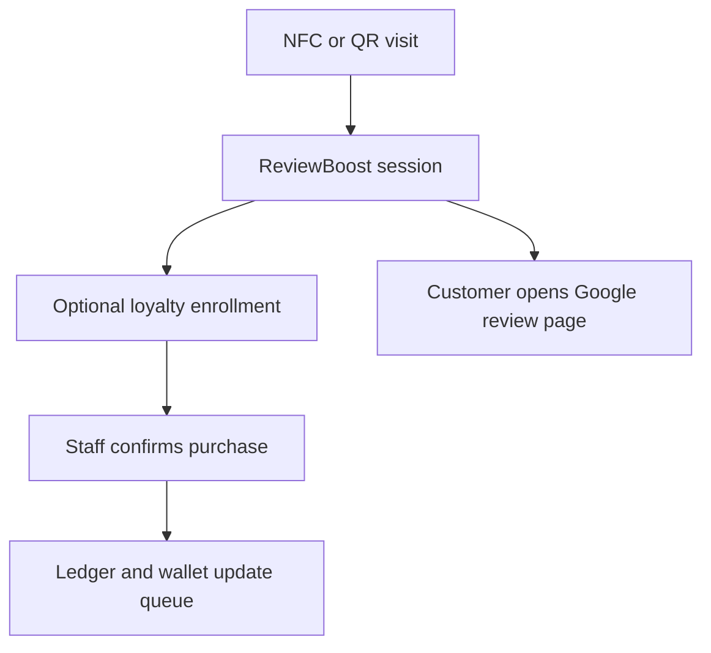

# Optional loyalty and engagement foundation

Implemented backend, not a wallet launch. All features default off. The
existing `/q/{token}` review journey and its equal public review opportunity
are unchanged. No customer marketing, wallet passes, or ads are sent by this
change.

## One tap and two connected jobs

The NFC tag opens a ReviewBoost URL. The customer chooses whether to join
loyalty and separately whether to receive reminders. Enrollment uses the
existing anonymous session without tying that session's private rating to a
named person. Its opaque member capability can later be encoded into a wallet
barcode. An existing member should present that capability, rather than enroll
again on each visit. Cross-device recovery and duplicate-member merging are
not implemented.



A tag cannot silently install a wallet pass, authorize notifications, prove
payment, or publish a customer's Google review. Wallet enrollment still needs
the platform's Add action. Review text and publication remain the customer's
action on Google. NFC/QR sessions are not verified unique people or confirmed
physical visits.

## Implemented

- Owner/admin settings: master switch, loyalty switch, reminder switch,
  purchase target (2–100), and reward description. Settings changes are audited.
- Explicit loyalty acceptance and separate reminder consent. Enrollment is
  idempotent per unexpired, stand-scoped public session. A replay returns the
  same encrypted capability. Conflicting consent input is refused.
- Token-authorized withdrawal, including while the business has disabled its
  program. Withdrawal revokes reminder consent and blocks future earning.
- Staff-confirmed purchase and reward-redemption ledger. There is no public
  earn endpoint. A purchase reference is unique per business and transaction
  kind, including across different members. Replays return the original result.
- Atomic balance changes and an outbox entry for each member revision. Jobs
  are **pending**, never reported as delivered or installed.
- Read-only message draft decisions using database balances and purchase
  history, not caller-supplied customer activity.
- Aggregate sessions, Google handoffs, enrollment, confirmed purchases,
  redemptions, and pending wallet updates. Published reviews are `null`, not
  zero. Individual review attribution is `unavailable`.
- RLS tenant isolation, capability-column protection, no browser write grants,
  and explicit function execution grants. Public operations are rate-limited.

## Decision algorithm

1. Require the business's three switches and the customer's current reminder
   consent. Suppress withdrawn members.
2. Keep a stable 10% control group per business/member. This creates a future
   comparison group; no lift estimate is calculated yet.
3. Suppress marketing within seven days of a recorded delivery. Suppress
   outside 09:00–20:00 in the business timezone.
4. Prefer a genuinely available reward, then being one qualifying purchase
   away from a reward, then a return reminder after fourteen days without a
   qualifying purchase. Otherwise prepare no message.
5. Return a draft with `delivery: not_configured`. A draft is never a send.

Examples: “Your reward is ready”, “One visit away”, “Your next visit counts”.
The reward description is configured by the business. No invented discounts,
guaranteed savings, fabricated scarcity, or inferred Google review status.

This is a deterministic rules engine, not a trained AI model. The useful
optimization target is incremental confirmed repeat purchases and reward cost,
not repeated tapping. Future delivery experiments need recorded assignment,
provider acknowledgments, redemption attribution, and adequate sample sizes
before reporting causal improvement. Do not claim Google review lift from this
holdout: individual review outcomes cannot be linked to these members.

## API

Owner routes use a Supabase bearer token and the existing selected organization
mechanism. The server uses the caller's database client; `org_id` is never
taken from a customer body as authorization.

| Endpoint | Method | Purpose |
| --- | --- | --- |
| `/api/v1/engagement` | GET | Settings, default off, plus delivery capability |
| `/api/v1/engagement` | PUT | Owner/admin replaces all five settings |
| `/api/v1/engagement/summary?since=ISO_TIMESTAMP` | GET | Observations since date; defaults to 30 days, maximum 365 days |
| `/api/v1/engagement/preview` | POST | Owner/admin draft for `{memberId}` using server data |
| `/api/v1/loyalty/transactions` | POST | Owner/admin/member confirms purchase or redemption |
| `/api/v1/public/q/{token}/loyalty` | POST | Optional customer enrollment |
| `/api/v1/public/loyalty/withdraw` | POST | Customer withdraws via member capability |

Settings body:

```json
{"enabled":true,"loyaltyEnabled":true,"remindersEnabled":false,"stampsRequired":10,"rewardLabel":"A free coffee"}
```

Enrollment body:

```json
{"sessionId":"EXISTING_OPAQUE_SESSION_CAPABILITY","acceptLoyalty":true,"remindersConsent":false}
```

The response includes `memberToken`, `stamps`, `rewards`, and
`walletDelivery: not_configured`; it is not an Add to Wallet link. Enrollment
does not require accepting reminders. Store the capability securely and do not
put it in analytics or logs. The staff scan uses the capability:

```json
{"memberToken":"OPAQUE_MEMBER_CAPABILITY","kind":"earn","purchaseReference":"receipt-unique-reference"}
```

`kind: redeem` consumes one earned reward. Use a unique redemption reference,
and preserve it on retries. Two different references mean two transactions;
the system cannot detect a cashier inventing purchases. A verified POS adapter
is required for independently verified purchases. Changing a program's purchase
target changes the threshold used on the next earning transaction.

Withdrawal body is `{ "memberToken": "OPAQUE_MEMBER_CAPABILITY" }`; success
is 204 for both an existing and an unknown capability. There is no automatic
re-enrollment of withdrawn members. Re-enrollment needs a new explicit action
and a new session.

## Required before a customer launch

The following are not part of this backend foundation:

- Customer enrollment UI, staff camera scanner, and owner controls in the UI.
- Signed Apple `.pkpass` issuance, Apple device registration, APNs updates,
  certificate management, Google Wallet objects, and Save to Wallet links.
- A wallet provider worker. It must read the latest member revision, recheck
  enabled/withdrawn state, handle provider-specific delivery separately,
  acknowledge accepted revisions, retry safely, and handle deleted passes.
  Updating a card balance and sending marketing must be separate operations.
- Actual reminder delivery, delivery history, scheduling, and experiment
  measurement. `last_marketing_delivered_at` must be written only by a future
  trusted sender after an accepted send; it is never writable by a browser.
- Google Business Profile OAuth, review synchronization and Pub/Sub. The API
  review resource exposes reviewer name/photo/anonymous flag, not our session,
  member token, or reviewer email. A new review can be observed independently;
  a name/time similarity cannot establish exact attribution or causation.

Google documentation:
https://developers.google.com/my-business/reference/rest/v4/accounts.locations.reviews
https://developers.google.com/my-business/content/notification-setup
https://developers.google.com/wallet/retail/loyalty-cards/use-cases/trigger-push-notifications
Apple documentation:
https://developer.apple.com/wallet/get-started/
https://developer.apple.com/documentation/walletpasses/adding-a-web-service-to-update-passes

Keep rewards tied to qualifying purchases, not Google reviews. Saving a pass
does not automatically disclose a phone number or email or authorize SMS.

## Verification and rollout

Run `npm ci`, `npm run typecheck`, `npm run lint`, `npm test`, and
`npm run build` from `frontend/`. The new embedded PostgreSQL tests execute
the actual new migration and role checks against a minimal existing-schema
fixture. They do not replace a full Supabase migration reset, production RLS
advisors, multi-connection contention tests, or real device/provider tests.

Apply the migration first in an isolated Supabase branch, run the repository's
full database tests and advisors, and leave all flags off until the missing
wallet/UI work and device tests are complete. This change does not apply any
migration or modify any live business.

Validation recorded for this change: production build, TypeScript, and ESLint
passed. All 18 new decision/database tests and all 42 existing public-contract
tests passed. An earlier full run passed 490 tests and failed the existing
`owner-data` Asia/Kolkata month-start test; that same failure was reproduced
in an unchanged checkout of main `0155948`. A full Supabase reset, advisors,
provider send, and physical-device test were not run.
