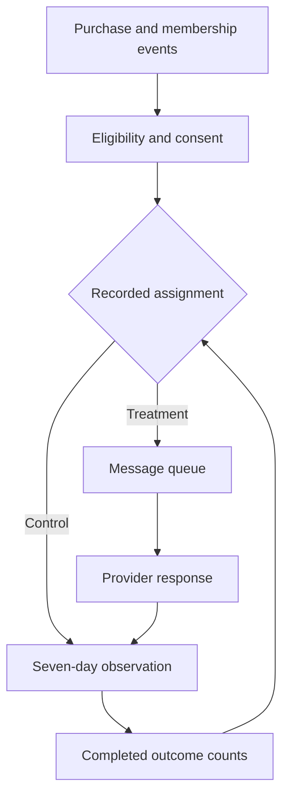

# Loyalty and adaptive engagement

This change implements the loyalty ledger, an owner console at `/engagement`,
recorded experiments, a learning message selector, provider dispatch, and a
scheduler definition. Programs, reminders, campaigns, and the scheduler start
off. No production migration or live send was performed while developing it.

## Behavior

The existing NFC/QR review flow remains independent. Optional loyalty
acceptance and reminder consent are separate. Purchase rewards require an
authorized staff purchase record; a repeated public tap never earns stamps.
Purchase references are idempotent across members within a business.

An enabled campaign selects a relevant message for an opted-in member with an
active destination. Eligible campaigns are an earned reward, being one
qualifying purchase away, and a return reminder after fourteen days without a
recorded purchase. One stable 10% business/member holdout receives no campaign
message. Treatment messages use two approved templates per campaign.

Before twenty completed accepted-send observations, template selection explores
uniformly. After that, a Beta-Bernoulli Thompson sampler uses
`Beta(1 + observed conversions, 1 + no observed conversion)` for each template,
with continuing 10% uniform exploration. Statistics use the business's own
campaign observations from the past ninety days. Each decision stores the
selected template, algorithm version, and the counts used to select it.

Pending observation windows do not count as failures. Rejected, uncertain,
cancelled, and control sends never enter the message response model. The
learner's positive outcome requires a recorded purchase after provider
acceptance and before the assignment's seven-day observation closes.

This is an implemented statistical learner, not an LLM, and does not require an
OpenAI API key or GPU. It learns observed response, not causal uplift.

## Metrics and interpretation

Enrollment, withdrawal, staff-confirmed purchases, redemption, assignment,
queueing, attempts, provider acceptance/rejection, and uncertain responses are
recorded as durable first-party events. The report distinguishes pending
windows from completed windows, and keeps all treatment assignments in the
comparison report even if delivery fails. This avoids removing failed sends
from the treatment denominator.

The unit shown in the report is an assignment window. Members can appear in
multiple windows. Repeated members, adaptive template selection, incomplete
purchase capture, and small samples mean these descriptive rates and optional
Wilson intervals must not be presented as proof of a winner or causal lift.
A missing purchase means no purchase was recorded, not proof the person never
returned. POS integration and complete staff recording improve this signal.
The code does not calculate profit without verified prices and reward costs.

Sessions, Google review handoffs, loyalty purchases, and published Google
reviews remain separate observations. Reviewer names/times are not exact
customer attribution. Google Business Profile synchronization is not included.
No private rating is used to choose recipients or variants.

## Delivery

An authenticated worker prepares a bounded batch and claims pending messages
using row locks and leases. Eligibility, active campaign, destination state,
consent, withdrawal, and daytime hours are rechecked before a send. Attempted
or accepted/uncertain messages impose a seven-day cooldown. A unique weekly
business/member assignment and active observation window prevent duplicates
across campaigns and channels. Queued messages older than one day expire.

Google Wallet transport uses Google's service-account auth library and
`loyaltyObject/{id}/addMessage` with `TEXT_AND_NOTIFY`. It checks `hasUsers`
before submitting a message. A Google success is provider acceptance, not a
phone display, read receipt, or confirmed customer visit. Notification settings
and Google's delivery controls still apply.

Google message IDs are not idempotency guarantees. A network timeout, ambiguous
server response, or expired in-flight lease becomes `unknown`, and is never
blindly requeued. A database failure after acceptance is likewise not permission
to resend. Manual provider reconciliation is needed for ambiguous sends. An
already in-flight request can finish after an opt-out; no further eligible
assignment is created for that member.

The optional HTTPS delivery gateway receives `{id, memberId, target, title,
body}` with a bearer secret and `Idempotency-Key: id`. Its contract is
`{accepted: true, reference: "provider-receipt"}` or `{accepted: false}`.
A malformed success receipt, HTTP 5xx, or timeout is unknown. A known rejection
is rejected. The gateway must enforce its channel's consent, content, and
platform rules. Direct Apple Wallet issuance/APNs transport is not included.

## APIs

Owner routes use a verified Supabase bearer token and the existing selected
organization header/cookie. Owner reads/writes use the caller's database
client. RLS, column grants, and narrow RPCs enforce tenant boundaries; customer
capabilities and delivery target details are not exposed through owner table
selects. All public function grants are explicit.

| Endpoint | Method | Purpose |
| --- | --- | --- |
| `/api/v1/engagement` | GET / PUT | Read/replace the five program settings |
| `/api/v1/engagement/summary` | GET | Sessions, handoffs, enrollment, purchases, redemptions |
| `/api/v1/engagement/preview` | POST | Read-only rule preview for `{memberId}` |
| `/api/v1/engagement/experiments` | GET | Campaigns, cohorts, variants, events, recent decisions, member destinations |
| `/api/v1/engagement/experiments` | POST | `{campaign, active}`; owner/admin only |
| `/api/v1/engagement/run` | POST | Prepare eligible assignments; does not bypass delivery worker authorization |
| `/api/v1/engagement/destinations` | POST | `{memberId, provider, active}`; owner/admin only |
| `/api/v1/internal/engagement/dispatch` | GET / POST | Secret-authenticated preparation and dispatch batch |
| `/api/v1/loyalty/transactions` | POST | Staff-confirmed `{memberToken, kind, purchaseReference}` |
| `/api/v1/public/q/{token}/loyalty` | POST | Explicit `{sessionId, acceptLoyalty: true, remindersConsent}` |
| `/api/v1/public/loyalty/withdraw` | POST | `{memberToken}`; withdrawal also works while disabled |

Campaign names are `reward_ready`, `one_visit_away`, and `return_visit`.
Provider names are `google_wallet` and `webhook`. A webhook destination is the
member UUID, never a user-entered network URL. The gateway resolves that
identifier to its opted-in subscriber. Google object IDs are
`ISSUER.rb_SHA256(orgId:memberId)[0:40]`. The wallet issuer must provision and
save that object; this code does not create wallet passes. Active Google
registration verifies the pass with Google. The sender repeats that check
before a message, including when a direct owner RPC configured a destination.

Enrollment returns an opaque member capability and the current balance. It is
idempotent per unexpired stand-scoped session. Preserve that capability for
repeat visits; enrolling on every tap creates separate memberships. Cross-device
recovery/merging, customer enrollment screens, and a camera scanner are not
included. Unknown and existing withdrawal capabilities both return 204.

## Configuration and scheduler

Server-only configuration is documented in `frontend/.env.example`:

- `ENGAGEMENT_WORKER_SECRET`: at least 32 characters. The worker also accepts a
  configured `CRON_SECRET` of at least 32 characters. SMS-specific worker
  credentials do not authorize this endpoint.
- `GOOGLE_WALLET_ISSUER_ID` and `GOOGLE_WALLET_SERVICE_ACCOUNT_JSON`: issuer
  access for existing loyalty passes. A configured credential is not proof the
  account has been live-verified.
- `ENGAGEMENT_DELIVERY_WEBHOOK_URL` and
  `ENGAGEMENT_DELIVERY_WEBHOOK_SECRET`: optional HTTPS gateway and 32+ character
  bearer credential. No provider configuration means no preparation or sends.

`.github/workflows/engagement-worker.yml` defines an opt-in fifteen-minute
scheduler and manual dispatch. It runs only when repository variable
`ENGAGEMENT_AUTOMATION_ENABLED` is `true`. Configure repository variable
`ENGAGEMENT_WORKER_URL` with the HTTPS dispatch endpoint and repository secret
`ENGAGEMENT_WORKER_SECRET` matching the runtime secret. The workflow has no
repository write permission and no pull-request trigger. Scheduled workflows
run from the default branch and GitHub does not guarantee exact execution time.
The development change does not enable that repository variable or any live
program. A batch prepares up to three members for one rotating business and
attempts up to three queued sends; increase capacity only with runtime budget
and provider verification.

## Verification and release boundary

The automated tests execute both new migrations in embedded PostgreSQL against
a minimal fixture for the existing tenant/session schema. They exercise actual
role checks, tenant isolation, durable holdouts, leases, opt-out cancellation,
quiet-hour deferral, purchase-window attribution, and the full selection ->
HTTP receipt -> purchase -> learning path. HTTP transports are mocked; these
are not live Google or gateway sends. Statistical tests verify that preferences
change with outcomes and exploration continues. Component tests verify owner
scope, disabled delivery controls, and truthful error states.

Run `npm run typecheck`, `npm run lint`, `npm test`, `npm run build`, and
`npm run test:production-fixtures` from `frontend/`. Full Supabase resets,
production advisors, true multi-connection contention, real device tests, and
live provider delivery still require an isolated deployment and credentials.
Apply both migrations in order and verify provider/pass setup before enabling
programs, campaigns, and the scheduler. A previous full-suite failure in the
Asia/Kolkata month-start test was reproduced on unchanged main; this feature
does not modify that date helper.

Recorded validation for this implementation: 27 focused adaptive/database,
provider, and owner-console tests passed. TypeScript, ESLint, the production
build, the production-fixture guard, and whitespace checks passed. The full
suite run passed 518 tests and retained the existing Asia/Kolkata month-start
failure. Browser visual QA was attempted but blocked by the execution
environment's Chromium socket restriction; component checks passed, but no
browser layout verification is claimed. No live customer messages were sent.
