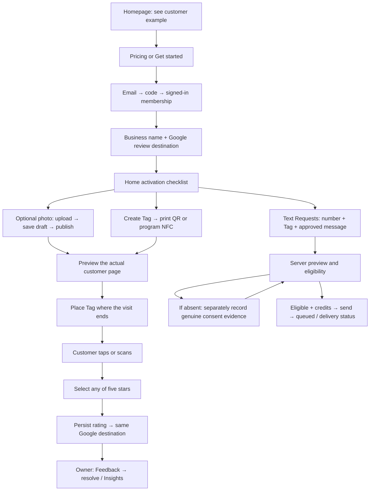

# PR #67: route audit and implementation contract

Baseline checked 2026-10-12: PR67 `1036e2e`, main `0155948` (ancestor of PR67), PR76 `1246a28`. PR76 now includes Connections; only its Phase 0 consent commit `ef9f011` belongs in this change. PR75 supplies the approved white hero/footer and rendered phone hardware; PR77 is retention documentation, not a launch requirement. Refresh remote refs before pushing. No new PR, force push, merge, deploy, production migration or live messaging.

## Who this serves
Local restaurants, barbers, salons and similar service businesses. The owner needs a simple, repeatable after-visit habit, a clear view of feedback, and a cost they understand. Customers need a quick, neutral path without an account. Long-term value comes from reliable collection, useful feedback and predictable operations; conversion or retention improvement is a hypothesis to measure, not a claim to fabricate.

## Existing strengths to retain
Four mobile tabs; secondary Settings; a shared CustomerVisitView for editor/live; real Stripe-derived entitlements and SMS ledger; authenticated owner APIs; rating trend/distribution charts with sample-size guards; direct rating save and Google handoff for every score; QR/NFC lifecycle and token rotation. Current main is already an ancestor: preserve its contracts plus PR67's tested additions, rather than reverting newer functionality to main's older files.

## Page count
30 Next.js page route patterns before this pass. Dynamic identifiers count once, not once per customer/Tag. 37 route-handler files before the consent endpoint; API endpoints are not pages. 11 native screen files plus 2 navigation layouts in Expo (not another 13 web pages).

## Route-by-route plan (published before this pass's code changes)
| Route | Existing purpose | Decision |
|---|---|---|
| `/` | Public homepage, pricing, examples | Preserve story and real pricing; verify rendered product demo and add an obvious example jump. |
| `/product` | Product explanation + example | Preserve shared demo; explain physical Tag → private rating → Google clearly. |
| `/how-it-works` | Sequential explanation | Preserve; verify setup/reprint instructions and links. |
| `/pricing` | Canonical plans | Preserve actual catalog; carry chosen plan through login/setup; no invented trial. |
| `/integrity` | Equal Google opportunity | Preserve approved policy. |
| `/security` | Security facts | Preserve verifiable claims; no invented certification. |
| `/privacy` | Privacy policy | Preserve policy; accessible link color. |
| `/terms` | Terms | Preserve policy; accessible link color. |
| `/support` | Support guidance | Preserve working contacts and recovery paths. |
| `/delete-account` | Public deletion guidance | Preserve connection to authenticated deletion. |
| `/goodbye` | Deletion completion | Preserve. |
| `/offline` | Offline fallback | Preserve retry and cached/offline honesty. |
| `/login` | Email OTP | Preserve email on errors; prevent stuck submitting state. |
| `/select-org` | Tenant selection | Preserve membership-based access. |
| `/onboarding` | Business + Google setup | Preserve saved values/plan; route into existing Home activation checklist. Optional photo and first Tag follow there; no duplicate onboarding platform. |
| `/home` | Readiness + next action | Preserve concise summary, real counts and one useful next step. |
| `/feedback` | Needs you / Everything | Preserve backend unresolved semantics, filters and pagination. Do not invent a low-star attention threshold. |
| `/feedback/[responseId]` | Detail + owner workflow | Preserve actual status transitions, notes and Back behavior. |
| `/feedback/insights` | Rating trend/distribution | Already built. Preserve real data, date range, sample guards and accessible chart detail. |
| `/text-requests` | One-to-one SMS | Port PR76 Phase 0: approved templates, exact server preview, eligibility, separate evidence-backed consent; retain PR67 roles and compact recent list. |
| `/stands` | Tags inventory/create | Preserve; clear first-Tag action and inactive/readiness states. |
| `/stands/[standId]` | QR/NFC setup/reprint/rotate | Preserve; fix rotated Tag requiring reprogramming, disabled unready print, stable preview link. |
| `/customer-page` | Photo editor + shared preview | White empty hero, gray bolt footer; preserve fixed lower panel; recoverable load/save/publish states. |
| `/settings` | Business/account options | Preserve working fields, role gates and offline recovery. No fake Connections controls. |
| `/settings/billing` | Subscription/checkout/portal | Actual Stripe authority; preserve plan choice and safe return route. |
| `/settings/delete` | Account deletion | Preserve confirmations and backend behavior. |
| `/q/[token]` | Live anonymous customer flow | Same renderer; all five scores save then hand off; no Continue, note or praise step. |
| `/reviews` | Legacy redirect | Keep redirect to Insights. |
| `/praise` | Legacy Team page, outside launch navigation | Redirect to Feedback; keep backend/history untouched. |
| `/customers` | Legacy response summary, outside launch navigation | Redirect to Feedback; no invented customer CRM. |

After redirects: 27 rendered web pages + 3 compatibility redirects = 30 route patterns. Public/system: 12; auth/setup: 3; daily owner/supporting pages: 11; live customer: 1. Error/loading boundaries and query-filter states are not additional pages.

## Full journey and button behavior

A preview cannot spend credits or create consent. Sending cannot create consent. A connection cannot create consent. An external Google handoff is not evidence a review was posted. Existing chart counts are ReviewBoost ratings, not Google review completions.

## Design contract
Refine existing components and forest-green identity. Product mode is quiet and task-oriented; public pages show the actual product. Geist remains app typography, Inter Tight/DM Sans remain the approved customer composition. Keep current motion tokens and reduced-motion behavior; do not add decorative motion. The supplied customer reference is authoritative for white absent-photo hero and small gray lightning/footer; its lower rating panel and approved words remain shared. Stripe template informs hierarchy, tabular amounts and disciplined spacing, not purple gradients or proprietary fonts. shadcn is a reference for semantic variants, labels and focus, not a reason to replace working primitives.

## Research provenance and constraints
The uploaded 45-page blueprint is user-provided reference, not authority to ship its proposed Connections/retention platforms or production operations. Its external citations are pointers, not newly verified sources. Attempts to fetch NiceJob, GatherUp and GitHub's API returned proxy HTTP 403; no web-search or Figma tools are exposed. Native Git fetch works. Therefore current competitor features/prices, competitive failings and Figma parity are not claimed. Useful comparison hypotheses to validate: time to first usable Tag, number of setup decisions, transparent trial/limits, evidence of consent, clarity of delivery failures, and honest review metrics. Do not market unverified superiority. User-selected public source repos were fetched and inspected at pinned commits (see design reference lock).

## Acceptance
Real browser at 390, 768 and 1280px; extra 320px reflow. Inspect loaded states, not just HTTP 200. Check keyboard, reduced motion, light/dark, empty/loading/error/success and photo/no-photo. Run TypeScript, lint, relevant unit/a11y/integration, local pgTAP, browser tests and production build. Live Stripe/Twilio, actual NFC hardware, App Store and production migration remain external verification gates.

## Later upstream comparison
PR75 customer renderer, phone hardware and matching CSS were reused directly, with this pass’s editor layout retained. After source review exposed real account-flow defects, PR75 account-deletion confirmation ordering, public RPC access, terminal billing webhook cleanup and App Review rate-limit fixes were also ported with their tests. No live account deletion or billing operation was performed.
